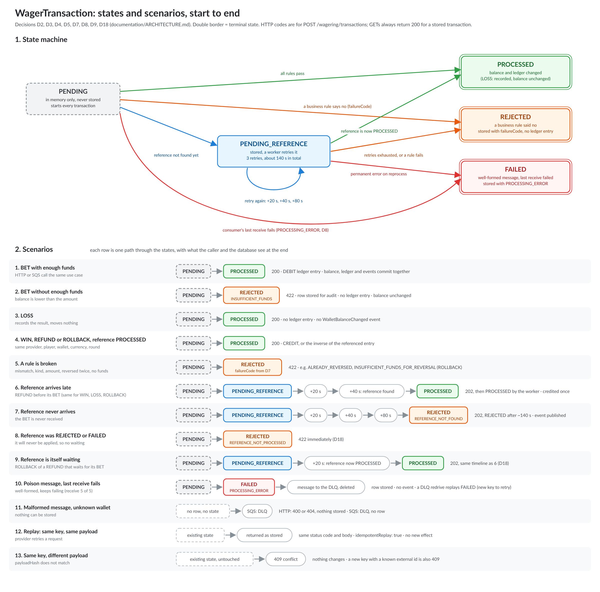

# Architecture decisions

Section numbers in brackets refer to `README.md`. Decision numbers (D1 to D18) follow `plan.md`; every one is taken. Reading order for a reviewer: this index, then the concurrency walkthrough, the limitations and the not-implemented list at the end. Values a provider sees are in `taxonomy.md`; commands in `tests.md` and `deployment.md`.

| Area | Section | Decisions |
|---|---|---|
| Money | Money value object | D10 |
| State and retries | State machine and scenarios | D2, D3, D8 |
| Concurrency | Concurrency, walkthrough, multi-instance | D1 |
| Idempotency | Idempotency | D6 |
| References | References and reversals, failure codes | D4, D5, D7, D18 |
| HTTP | HTTP status mapping, HTTP layer | D9, D13, D15 |
| Persistence | Persistence | D10, D11, D17 |
| Messaging | Outbox publisher, SQS consumer | D12 |
| Observability | Observability | D14 |
| Documentation | Documentation | D16 |

## Money value object [6.1, 5.1]

Code: `../src/money/money.ts`, DTO `src/money/dto/money.props.dto.ts`, tests `test/unit/money/money.spec.ts`.

### Decisions

| Decision | Choice | Why |
|---|---|---|
| Decimal type | `decimal.js` (`Decimal`), declared in `package.json` | README skeleton types `value` as `Decimal`. Exact base-10 arithmetic; no `number` anywhere in the class (eliminatory rule 5.1). The alternative was `bigint` minor units: no dependency, but it drifts from the README signature and needs manual parsing/formatting |
| Boundary representation | `amount` is always a decimal **string**, `currency` a string | JSON numbers are IEEE doubles, so a string is the only lossless wire format |
| Scale | Fixed at 2, enforced on input with `/^-?\d+\.\d{2}$/` and on output with `toFixed(2)` | Rejects `NaN`, `Infinity`, `1e3`, empty, `25`, `25.0`, `1.005`, `1,00`. `toFixed` avoids `Decimal.toString()` emitting `"25"` or `"1e+21"` |
| Currency | `/^[A-Z]{3}$/` shape check only | ISO-4217 shape is enough for the challenge. No code list, so `XXX` or `ZZZ` pass |
| Immutability | `private constructor`, `readonly` fields, every operation returns a new `Money` | README 6.1. `Decimal` operations are themselves immutable |
| Currency mismatch | `add`, `subtract`, `isLessThan` **and `equals`** throw | A cross-currency comparison is a programming error, not a "false" answer. A silent `false` from `equals` would hide a wallet/transaction currency bug. Trade-off: `equals` is not usable as a general predicate across unknown currencies |
| Sign handling in `from` | Negative amounts are **accepted** by `Money.from` | Balances, `subtract` results and ledger `balanceBefore/After` can be negative intermediates, and `negate()` must round-trip through `toJSON`/`from`. "No negatives in input contracts" (6.1) is enforced at the request DTO validation layer, not in the value object |
| Sign predicates | `isPositive` is `gt(0)`, `isNegative` is `lt(0)` | `Decimal.isPositive()` returns `true` for zero |
| Domain purity | No imports from `@nestjs/*` or `@mikro-orm/*` | README 6.1. Persistence mapping lives in an `EntitySchema` (infrastructure layer) |

### Still open (Money)

- **Rounding/division.** None exists. Scale is fixed at 2 and there is no multiply/divide, so rounding mode is not a decision yet. If fees or splits are added, a rounding mode (banker's vs half-up) must be chosen explicitly.
- **Max amount.** `Decimal` has no overflow, but the database column (`numeric(19,2)`) does; the request DTO limits it to the column range (`^\d{1,16}\.\d{2}$`).
- **Currency list.** Only the shape is checked; the model is multi-currency but only `BRL` is exercised.

Done since the first draft: typed errors (`InvalidMoneyError`, `CurrencyMismatchError`), persistence mapping (D10), request validation (D13).

## State machine and scenarios [6.3, 7, 7.1] (D2, D3, D8)

Source of the picture: `wager-transaction-states.svg` (same folder). Thirteen scenarios are drawn from start to end, including the ones that never create a row.

### Decisions

| Decision | Choice | Rejected alternative and why | Consequence |
|---|---|---|---|
| D2 Transitions | `PENDING` to `PENDING_REFERENCE`, `PROCESSED`, `REJECTED` or `FAILED`. `PENDING_REFERENCE` to itself (one retry step), `PROCESSED`, `REJECTED` or `FAILED`. `PROCESSED`, `REJECTED` and `FAILED` are terminal; a transition out of them throws `InvalidTransactionStateError`. `processedAt` is set only on `PROCESSED`. `PENDING` is never stored: it is the in-memory start state inside one SQL transaction | Forbidding the self-transition. It was smaller, but a retry would then change nothing in the object and the retry rule would live outside the domain | The retry is a domain event, so the retry state is domain state (D3) |
| D3 Retry state and limit | `attempts` and `nextAttemptAt` are fields of `WagerTransaction` and columns of the row. `markPendingReference(now)` is the retry step. **3 retries**, no TTL: the first miss schedules a retry at +20 s, a miss then +40 s, a miss then +80 s, a miss after that is `REJECTED` with `REFERENCE_NOT_FOUND`, about 140 s after the first miss. Backoff `20 s * 2^n`, capped at 120 s (the cap never binds with 3 retries) | Keeping the counters only in the row (the domain would not own the rule); a separate retry table (a join and a second write for nothing); 5 attempts with a 10 minute TTL (the TTL could never trigger because the schedule ends at 2.5 minutes) | Two fields beyond the README constructor (listed under "Deviations"). A reference that arrives later than about 2 minutes finds the reversal already rejected; the provider resends with a new key |
| D8 `REJECTED` vs `FAILED` | `REJECTED`: a business rule said no (stored, acked, terminal, committed, never rolled back). `FAILED`: a well-formed message that failed on its last allowed receive; the consumer stores it with `PROCESSING_ERROR`, sends the message to the DLQ and deletes it. Malformed or wallet-less messages never get a row | Defining `FAILED` but never writing it (a dead state, no database trace of poison messages) | A `FAILED` row is terminal and keeps its key, so a DLQ redrive replays `FAILED`; to retry, resubmit with a new key. If storing `FAILED` itself fails (database down), SQS moves the message to the DLQ on its own and only the audit row is lost |

## Concurrency [8, 5.7, 5.8] (D1)

| Decision | Choice | Rejected alternative and why | Consequence |
|---|---|---|---|
| D1 Lock strategy | Pessimistic: `SELECT ... FOR UPDATE` on the wallet row as the first statement of the transaction. The unit of concurrency is the wallet, so wallets run in parallel and there is no global lock. The `UPDATE` also checks `WHERE version = ?` as a second guard, and the schema has `CHECK (balance >= 0)` as the last | **Optimistic `version` + retry:** best when contention is rare, but a hot wallet turns N concurrent writers into about N squared attempts, needs a retry cap, and idempotency needs its own race handling (catch the unique violation). **Atomic conditional `UPDATE`:** the balance rule moves into SQL and bypasses the `Wallet` class, the reference and reversal rules still need reads under a lock, and the row lock is held until commit anyway, so it saves one round trip, not blocking | Everything for one wallet is serialised: the idempotency lookup, the reference lookup, the "already reversed" check and the balance change see a stable state. Cost: a hot wallet queues in Postgres, each waiter holding a connection, so the transaction must stay short and use `lock_timeout` (answer 503 on timeout). Only one lock per transaction (its own wallet), so no deadlocks |

**Validated (phase 4, test 15).** The contention experiment is under "Use case wiring" ("Contention experiment"): a hot wallet is exact at every pool size, slower than 200 wallets, and a pool of 200 exhausts Postgres connections (100 calls failed). The change trigger and the alternative stay as written above: hot-wallet p95 above target or `lock_timeout` under normal load moves cold wallets to optimistic with a bounded retry.

## Idempotency [9, 5.2] (D6)

| Decision | Choice | Rejected alternative and why | Consequence |
|---|---|---|---|
| Key | The `Idempotency-Key` header is the source of truth for HTTP, `data.idempotencyKey` for SQS. Any non-empty string up to 255 characters; `provider:externalId` is a recommended default, not enforced | Deriving the key from the body (the README says the header is the source of truth) | The key is looked up after the wallet lock, so the lookup has no race; the unique index is the backstop |
| Uniqueness | `UNIQUE (provider_id, idempotency_key)` and `UNIQUE (provider_id, external_transaction_id)` | Only the key. References are resolved by `(provider, externalTransactionId)` (rule 2), which is only meaningful if that pair is unique | Two guarantees in the schema, not in code |
| Payload hash | `sha256` of the canonical JSON (keys sorted, absent optionals omitted) of nine business fields: `providerId`, `externalTransactionId`, `playerId`, `walletId`, `roundId`, `gameId`, `kind`, `money`, `referenceExternalTransactionId`. The key and transport metadata are not inputs | Hashing the raw body (key order and whitespace would change the hash) | Same key and same hash: replay of the stored result with `idempotentReplay: true`. Same key, different hash: 409, never a replay |
| New key, known external id | Always 409 (`DuplicateExternalTransactionError`), even when the payload matches | Treating the external id as a second dedup key and replaying when the hash matches: friendlier to clients that generate a key per retry, but the key stops being the only source of truth and there are two dedup paths to test | The provider must reuse its key on retry |
| Replay of a pending transaction | Returns the current state of the row (still `PENDING_REFERENCE`, or the final result once the worker resolved it) | | "Original result" (rule 7) applies to terminal states |

## References and reversals [7] (D4, D5, D18)

| Decision | Choice | Rejected alternative and why | Consequence |
|---|---|---|---|
| D4 Rules by kind | `BET` and `OPENING`: no reference. `REFUND` and `ROLLBACK`: reference required. `WIN` and `LOSS`: reference optional, **but if supplied it follows the same rule as a reversal** (must resolve to a `PROCESSED` transaction of an allowed kind with the same provider, player, wallet, currency and round; otherwise it waits per D3 and ends `REJECTED` `REFERENCE_NOT_FOUND`). Allowed referenced kinds: `REFUND` to `BET`; `ROLLBACK` to `BET`, `WIN` or `REFUND`; `WIN` to `BET`; `LOSS` to `BET`. Amount greater than 0 except `LOSS`, which may be 0. `OPENING` is internal and blocked at the API and the consumer, not in the factory | Validate-if-found, never wait (a second code path, and a win can be credited for a bet that never arrives); forbid references on `WIN`/`LOSS` (contradicts the README sentence that a `WIN` may reference the `BET`) | One rule for every kind: if a reference is supplied it must resolve. A `WIN` that arrives before its `BET` is delayed up to about 140 s |
| D5 Rule 4 (no double reversal) | At most one `PROCESSED` reversal (`REFUND` or `ROLLBACK`) per referenced transaction. The second is `REJECTED` `ALREADY_REVERSED`. Enforced by a partial unique index on `reference_transaction_id WHERE status = 'PROCESSED' AND kind IN ('REFUND','ROLLBACK')` plus a lookup under the wallet lock | The literal text, "not twice by the same type of operation": one `REFUND` and one `ROLLBACK` per reference would let a `BET` be refunded and rolled back, crediting twice (the eliminatory "credito duplicado") | Stricter than the text, documented as our interpretation as the README asks. A `ROLLBACK` can still undo a `REFUND` by referencing the `REFUND`, which is a different transaction. A `BET` may be referenced by several `WIN`s |
| D18 Reference exists but is not `PROCESSED` | Reference `PENDING_REFERENCE`: the reversal also becomes `PENDING_REFERENCE` and follows the D3 timeline. Reference `REJECTED` or `FAILED`: reject at once with `REFERENCE_NOT_PROCESSED` | Treating every non-`PROCESSED` reference as "not found yet": simpler, but a reversal of a rejected bet would burn 140 s and report a misleading code | One extra branch in the use case |

## Failure codes [7.2] (D7)

Every business refusal is persisted as `REJECTED` with a stable `failureCode`, including currency and player mismatch (audit trail; the alternative was a plain 4xx with no row). A `REJECTED` transaction is terminal and its key is used, so "fix and resend" always means a new key and a new external id.

| Code | When | Provider should |
|---|---|---|
| `INSUFFICIENT_FUNDS` | `BET` larger than the balance | give up on this bet; resending changes nothing until the player has funds |
| `INSUFFICIENT_FUNDS_FOR_REVERSAL` | a `ROLLBACK` (of a `WIN` or a `REFUND`) would make the balance negative; a `REFUND` or a `ROLLBACK` of a `BET` credit, so they cannot | give up, manual review (README 7 rule 9: a different code from `INSUFFICIENT_FUNDS`) |
| `REFERENCE_NOT_FOUND` | the reference did not arrive within the D3 timeline | send the missing reference first, then resend with a new key and external id |
| `REFERENCE_NOT_PROCESSED` | the reference exists but is `REJECTED` or `FAILED` | give up, nothing was applied that could be reversed |
| `REFERENCE_MISMATCH` | the reference has another provider, player, wallet, currency or round | fix the payload |
| `INVALID_REFERENCE_KIND` | the reference kind is not allowed for this operation (D4) | fix the payload |
| `REVERSAL_AMOUNT_MISMATCH` | the amount differs from the reference (partial reversals are out of scope) | fix the payload |
| `CURRENCY_MISMATCH` | the operation currency differs from the wallet currency | fix the payload |
| `PLAYER_MISMATCH` | the wallet belongs to another player | fix the payload |
| `ALREADY_REVERSED` | the reference already has a processed reversal (D5) | give up, it is already done |
| `PROCESSING_ERROR` | **only on `FAILED`** (D8): well-formed message that failed on its last receive | resubmit with a new key once the fault is fixed |

## HTTP status mapping [9] (D9)

Rule: **status codes describe the request, not the stored state.** The outcome mapping applies to `POST /wagering/transactions`; the GET endpoints return 200 with `status` and `failureCode` in the body for any stored transaction, and 404 only for an unknown id. Every error body has a stable `code` and a `retryable` flag, so a provider never reads a message to decide whether to resend.

| Situation | Status | Stored? |
|---|---|---|
| Invalid body, bad money format, `OPENING` as kind, missing `Idempotency-Key` | 400 | no |
| Unknown wallet or transaction | 404 | no |
| Same key with a different payload; new key with a known external id; duplicate wallet; replay of a `FAILED` transaction | 409 | no (the `FAILED` row already exists) |
| Business rejection (`status: REJECTED`, `failureCode`); a replay returns the same 422 | 422 | yes |
| `PENDING_REFERENCE` | 202 | yes, retried by the worker |
| `PROCESSED`, replays included | 200 (`POST /wallets`: 201) | yes |
| Transient infrastructure failure (lock timeout, connection loss) | 503 with `Retry-After: 1` | no, safe to resend the same request |
| A bug (`INVALID_STATE`) or a non-`Error` throw | 500, message hidden | no |

**Implemented (phase 5).** Two functions hold the whole mapping, so no controller chooses a status:

- `toHttp(error)` (`src/http/toHttp.ts`) maps thrown errors, by `instanceof`, to `{status, code, message, retryable, headers?, details?}`. `BadRequestError`, `InvalidMoneyError`, `CurrencyMismatchError`, `InvalidWagerTransactionError`, `InvalidMovementError` are 400 `VALIDATION_ERROR` (zod issues in `details`); `WalletNotFoundError` and `TransactionNotFoundError` 404; `IdempotencyConflictError`, `DuplicateExternalTransactionError`, `DuplicateWalletError` 409 with their own codes; `InvalidTransactionStateError` 500 `INVALID_STATE` (a bug); Nest's `HttpException` keeps its status (unknown route, malformed JSON, the readiness probe's 503 with its checks as `details`); Postgres `55P03` (lock timeout, also read through `cause`), connection loss and any other `Error` are 503 `TEMPORARILY_UNAVAILABLE` with `Retry-After: 1` and `retryable: true`; a non-`Error` throw is 500. The message of a 5xx is never sent (a connection error can carry a host or a credential); the filter logs the real error.
- `toResponse(result)` (`src/http/transactionResponse.ts`) maps the *outcome* of `POST /wagering/transactions`: `PROCESSED` 200, `PENDING_REFERENCE` 202, `REJECTED` 422, `FAILED` 409. A business rejection is a response, not an exception. The GETs use `toStoredBody` and always answer 200.

Every `uuid` column is validated as `z.uuid()` at the boundary (wallet id, player id, transaction id in a path): without it Postgres raises `invalid input syntax for type uuid`, which would surface as a misleading retryable 503 (found by the first wagering e2e run).

Rejected alternative: 200 with `status: REJECTED` in the body (common in wallet APIs, but the provider has to parse the body to tell a rejection from a success, which the README asks to avoid), and applying the POST mapping to GETs (a successful read answering 422 breaks caching and tooling).

## Persistence [4, 5.9, 6.0] (D10, D11, D17)

| Decision | Choice | Rejected alternative and why | Consequence |
|---|---|---|---|
| D10 Money in the database | `numeric(19,2)` + `char(3)`, converted by mapper functions (no custom MikroORM type). Read as a string, never as a JS number. Maximum amount `9999999999999999.99` enforced at the API | `bigint` minor units: no decimal parsing, but it hard-codes 2 decimals in the schema, needs a conversion at every boundary and is not readable in the database | Exact decimal arithmetic and natural `CHECK` constraints in SQL; the reconciliation `SUM` is exact |
| D11 Domain to database | The domain classes never import `@mikro-orm/*` or `@nestjs/*`. `EntitySchema` row classes (`*.schema.ts`) plus mapper functions for inserts and plain reads. **The locking and aggregate queries are plain SQL** through the transactional `EntityManager`: wallet `FOR UPDATE`, outbox and pending-reference `FOR UPDATE SKIP LOCKED`, reconciliation `SUM`. No repository interfaces (one implementation each) | ORM lock modes (hide the lock behind an option and the v7 names are unverified); raw SQL everywhere (the README names MikroORM as the ORM) | The lock is readable in the repository. The boundary is the domain/mapper split, not an interface |
| D17 Ids and clock | `crypto.randomUUID()` (v4), generated by the caller and passed into `create`; the clock is a plain `now: Date` argument. Domain code never calls `randomUUID()` or `new Date()` | UUID v7 via the `uuid` package: time-ordered, one more dependency; random keys fragment the btree a little more, which does not matter here because the ledger has a `bigint seq` for ordering and pagination | Unit tests are deterministic |

### Schema notes (phase 3)

The guarantees live in the schema, not only in the code: `CHECK (balance >= 0)`, unique `(provider_id, external_transaction_id)` and `(provider_id, idempotency_key)`, a partial unique index allowing one `PROCESSED` reversal per referenced transaction (D5), and an append-only ledger. The migration (`src/migrations/Migration20261021104500_initial.ts`) is hand-written SQL because triggers, partial indexes and cross-column checks are not generated by the schema tool. One migration creates all five tables (wallets, transactions, ledger, inbox, outbox) so phases 6 and 7 only add workers.

| Note | Decision | Why |
|---|---|---|
| (a) Append-only ledger | The trigger is **row-level** (`BEFORE UPDATE OR DELETE ... FOR EACH ROW`). There is deliberately no `TRUNCATE` trigger | `UPDATE` and `DELETE` fail with `P0001`, but `TRUNCATE` still works, which the tests use for cleanup (`TRUNCATE ... RESTART IDENTITY CASCADE`). A superuser can still disable the trigger; the schema protects against application bugs, not against a DBA |
| (b) `seq` as cursor | `wallet_ledger_entries.seq` is `bigint GENERATED ALWAYS AS IDENTITY UNIQUE` and is the pagination cursor | Ledger writes for one wallet are serialised by the wallet lock (D1), so within a wallet `seq` order equals commit order. Across wallets it is only unique. **Not mapped in the row class yet** (inserts must never set it); map it read-only or read it in raw SQL when phase 5 needs pagination |
| (c) No deferred balance constraint | A constraint proving `wallets.balance = SUM(ledger)` was considered and **not built** | It costs a trigger and a `SUM` on every write. The reconciliation endpoint plus the test invariant cover it. Revisit if a second writer other than the use case ever touches `wallets` |
| (d) `OPENING` transactions | Internal opening credits use `provider_id = 'internal'`, `external_transaction_id = idempotency_key = 'opening:<walletId>'`, `round_id = game_id = 'opening'` | The `NOT NULL` columns need no special case, and the unique keys still make the opening idempotent |
| Entity discovery | `src/mikro-orm.config.ts` lists the five `*Schema` objects **explicitly**; there is no `*.schema.ts` glob | The glob is imported natively by Node, which cannot resolve the `.js` specifiers inside `.ts` sources, so under vitest the e2e boot failed. Cost: a new schema must be added to the list |
| Row classes and mappers | One plain row class per table, mapper functions for wallet, transaction and ledger entry. Inbox and outbox have no domain class, so no mapper. Nullable columns are `T \| null` in the row and `undefined` in the domain; `toRow` writes `null` | `numeric` comes back as a string (`"0.10"`, proven by the round-trip spec). The domain `version` is a plain column managed by the domain, not MikroORM's `version` property |
| Running migrations | `src/migrate.ts` (`up`, `down`, `status`) behind `bun run migration:*`; never on app boot. The scripts run under `bun`, not `node`, so `.env` (with its `${...}` interpolation) is read | Several instances start together; schema changes are a release step (see `deployment.md`) |
| Tests | Integration specs run against the real Postgres in the `${DATABASE_NAME}_test` database and rebuild the schema by running the migration | A mocked database cannot prove a constraint. `test/integration/schema.spec.ts` asserts each constraint by Postgres error code |

### Use case wiring (phase 4)

| Note | Decision | Why |
|---|---|---|
| Transaction shape | A use case's public `execute` prepares ids and the clock (`now`, `randomUUID()`), forks the `EntityManager` (`orm.em.fork()`), runs one `em.transactional`, and calls a private function that only sequences repository calls with the transactional `tx`. Pure builders (`buildOpeningTransaction`, `buildEvents`) do no I/O | A fork per call keeps the identity map out of parallel calls. Ids and clock come from outside the transaction body so every row and event of one call shares them (D17) |
| Errors translated after the rollback | A unique violation is turned into a typed error (`DuplicateWalletError`) in a `try/catch` around the whole `em.transactional`, not inside it | A failed statement aborts the Postgres transaction, so nothing can be executed after it inside the same transaction |
| Raw SQL joins the transaction explicitly | Raw SQL in a repository is `em.getConnection().execute(sql, params, 'all', em.getTransactionContext())`. Without the last two arguments it runs on another pool connection, outside the transaction | Found in phase 4 step 2: it did not see uncommitted rows, and it blocked forever on a row the transaction itself had locked. ORM methods (`findOne`, `insert`, `insertMany`, `nativeUpdate`) already join the transaction |
| Wallet writes | `lockById` is `findOne` with `PESSIMISTIC_WRITE`; `save` is a `nativeUpdate` guarded by `version = wallet.version - 1` and throws `Wallet version conflict` on zero rows | The domain bumps `version` in `debit`/`credit`, so the version read under the lock is one less. It assumes one movement between `lockById` and `save`, true for the use cases |
| Replays need `balanceAfter` | The wager finders return `{transaction, balanceAfter}`; `balanceAfter` is required on insert. It is a column, not domain state | A replay must answer with the original balance (test 3), and a `NULL` there would break it silently |
| Modules | Two Nest modules: `MessagingModule` (outbox and inbox repositories, exported) and `WalletModule` (wallet, ledger and wager repositories plus the use cases). There is **no** `WagerModule` | Every money movement touches wallet and wager in one transaction. Two modules importing each other would be a circular import, which Nest rejects at boot. If an independent consumer of the repositories appears, extract a shared module then |
| `OPENING` creation | `CreateWallet` writes wallet, `OPENING` transaction (balance zero skips it), ledger entry and the events `WalletBalanceChanged` and `WagerTransactionProcessed` in one transaction. The transaction row is inserted before the ledger row (foreign key) | README: the opening balance is created in the same SQL transaction. Negative or malformed amounts are rejected by `Money.from` before anything is written |
| Submit use case | `SubmitWagerTransactionUseCase.execute` prepares ids and clock, forks, runs one `em.transactional` and calls `run`: `SET LOCAL lock_timeout = '5s'` → `lockById` (`WalletNotFoundError` if missing) → `WagerTransaction.create` (bad request throws before any write) → `checkWallet` (`PLAYER_MISMATCH`, then `CURRENCY_MISMATCH`) or `apply` → `buildEvents` → `persist` → result. `apply` changes only in-memory objects (phase 7 `reprocess` reuses it); `persist` is the only function that writes | The rules exist once. A business rejection **returns and commits** (the `REJECTED` row is evidence, D8); only request errors throw and roll back. The command carries `Money` (the phase 5 controller builds it); `CreateWallet` takes `MoneyProps` because it is the only entry that creates `Money` itself |
| Submit order of checks | After the wallet lock: `WagerTransaction.create` → key lookup → external id lookup → `checkWallet` → `resolveReference` → `apply` → `persist`. The lookups run after the build because the payload hash comes from the built object, and after the lock because that is what makes them race-free | The first answer a provider sees must not depend on timing. Rejections of the same request always carry the same code: wallet mismatches, then reference outcome, then `checkReference`, then already reversed, then funds |
| Idempotency scoping | Lookup is by `(provider, key)`, not by wallet. The hash includes `walletId` and `money`, so the same key for another wallet or amount is `IdempotencyConflictError`; the same external id under a new key is `DuplicateExternalTransactionError`. A replay returns the stored row and its `balanceAfter` (never the current balance), writes nothing, and works for `REJECTED` rows too. A null `balanceAfter` on a stored row is a bug and throws a plain `Error` | The replay must equal the original answer (README rule 7). A replay of a still-pending row returns its current state |
| Cross-wallet same-key race | **Handled (phase 5, step 3).** Two first-time requests with the same key for *different* wallets do not share a lock, so the unique index makes one of them fail with `UniqueConstraintViolationException`. `execute` wraps the whole transactional attempt in a try/catch and retries **once**: the winner's row is committed by then, so the retry answers as a replay (same payload) or a 409 `IDEMPOTENCY_CONFLICT` (different wallet, so a different payload). The catch is around the whole `em.transactional`, never one statement, because a failed statement aborts the Postgres transaction. A second violation (another unique index) escapes, so there is no loop | Without the retry the loser was a 503 "retry me" (e2e test: `[200, 503]` instead of `[200, 409]`). One extra transaction in a rare path |
| `resolveReference` | Reads only. Outcomes: `none`, `pending` (reference unknown, or `PENDING`/`PENDING_REFERENCE`, D18), `rejected` (`REFERENCE_NOT_PROCESSED` for `REJECTED`/`FAILED`; the code from `checkReference`; `ALREADY_REVERSED` from `findReversalOf`, reversals only), `found`. The lookup is by `(provider, referenceExternalTransactionId)`, so a reference under another provider is *not found* (pending), not a mismatch | A pending outcome saves a `PENDING_REFERENCE` row, queues `WagerTransactionPendingReference` and moves no money; the worker that resolves it is phase 7. `REFERENCE_MISMATCH` is reached through another wallet or round; player and currency on the same wallet are caught earlier by `checkWallet` |
| Inbox in the submit transaction | `execute` returns `SubmitWagerOutcome`: `completed` (a `WagerResult`) or `duplicate-message`. With `ctx.inbox`, `run` does `tryInsert` as the very first statement, then `process` (the money flow above), then `markProcessed`, all in the one transaction. A duplicate delivery costs one insert and no wallet lock; a concurrent copy waits on the primary key until the first commits, then gets `duplicate-message`. A success, a business rejection and an idempotent replay all mark the row; a thrown error rolls the inbox row back with everything else, so the redelivery starts clean | The inbox dedups *messages* (`consumer_name`, `message_id`); the idempotency key dedups *requests*. Both stay. The wait on the inbox key is outside the 5 s `lock_timeout` (it only lasts one short transaction). Callers must branch on `kind` |
| Lock timeout (D1) | `lock_timeout` is `5s`, set with `SET LOCAL` as the first statement of each submit transaction | A request stuck behind a hot wallet fails instead of queueing forever. The contention experiment (step 9) measured a worst lock wait of 0.8 s with 200 concurrent bets on one wallet, so 5 s only fires at roughly 1,000 queued requests |
| Contention experiment (D1, test 15) | 200 concurrent `BET` of 1.00 (2026-10-21, one developer machine: 8 cores, Postgres 5432 in Docker on the same host; numbers are relative, not a benchmark). `lock wait` is the time inside `lockById`; `latency` is the whole call. Every run ends with the ledger invariant green.  \| run \| pool \| wallets \| total \| bets/s \| lock wait p50/p95/max \| latency p50/p95 \| `lock_timeout` \| other errors \| \|---\|---\|---\|---\|---\|---\|---\|---\|---\| \| 1 hot \| 10 \| 1 \| 891 ms \| 225 \| 36/54/65 ms \| 495/844 ms \| 0 \| 0 \| \| 2 hot \| 60 \| 1 \| 1008 ms \| 198 \| 253/289/301 ms \| 605/958 ms \| 0 \| 0 \| \| 3 hot \| 90 \| 1 \| 876 ms \| 228 \| 271/713/804 ms \| 521/841 ms \| 0 \| 0 \| \| 3b hot \| 200 \| 1 \| 758 ms \| 264 \| 233/407/423 ms \| 334/718 ms \| 0 \| **100** \| \| 4 baseline \| 60 \| 200 \| 363 ms \| 550 \| 14/19/34 ms \| 223/357 ms \| 0 \| 0 \| | The hot wallet is **slower but exact**: about 200 to 230 bets/s whatever the pool (the lock serialises it, roughly 4.5 ms per transaction), against about 530 to 550 bets/s when the same 200 bets spread over 200 wallets. No `lock_timeout` in any run: the worst wait was 0.8 s, so 5 s only fires when about 1,000 requests queue on one wallet. Run 3b is a **finding**: a pool of 200 failed 100 calls with `sorry, too many clients already`, because the pool is larger than Postgres `max_connections` (100 by default). The failures were clean errors and the invariant held. Rule: `DATABASE_POOL_MAX` must stay below `max_connections` minus the other clients (workers, migrations, psql). A bigger pool does not make one wallet faster | Keep pessimistic locking (D1). Revisit if the hot-wallet p95 wait goes above the 5 s timeout under normal load, or if timeouts appear in production metrics. The alternative for wallets measured as cold is optimistic `version` with a bounded retry, which lowers latency for uncontended wallets but costs retries on hot ones. Put the pool rule in `tests.md` and `deployment.md` |
| Persist order | wallet `save` (only if the balance moved) → wager insert (with `balanceAfter`) → ledger insert (if there is an entry) → outbox enqueue | The ledger row references the wager row (foreign key). A rejected wager stores the balance observed |
| Ledger pagination (phase 5) | Cursor is the monotonic `seq`: `WHERE wallet_id = ? AND seq > ? ORDER BY seq LIMIT limit+1`; the extra row decides `nextCursor`. The cursor is opaque base64url of `{"seq": n}`; anything that does not decode to an integer >= 0 is a 400. `limit` defaults to 50, is capped at 200, and a value below 1 or not an integer is a 400. `seq` is a read-model column (not mapped into the domain entry, because it is `GENERATED ALWAYS`) | An offset shifts every later row when an entry arrives between two requests; `seq > ?` does not. Rows are read in a plain SQL statement, so the select aliases `seq::text AS seq_text`: aliasing it as `seq` made `ORDER BY seq` sort the text (1, 10, 11, 12, 2), which the e2e chain assertion caught |
| Reconciliation (phase 5) | One statement joins the wallet to its ledger and returns the stored balance, the balance rebuilt from the ledger and their difference, all computed by Postgres on `numeric` (so the difference can be negative and never passes through a JS number). No lock and no extra isolation level: one statement is one snapshot. On a difference the controller logs at error level with the wallet id and both amounts and answers `consistent: false`; it never writes to the wallet and never adds a compensating entry | Two statements (read the wallet, then `sumByWallet`) could see different snapshots under concurrent writes and report a false mismatch. A metrics hook for the mismatch counter is marked in the controller (phase 9) |

## Deviations from the README skeletons

| Where | Deviation | Why |
|---|---|---|
| `SubmitWagerTransactionUseCase.execute` | Returns `SubmitWagerOutcome` (`completed` or `duplicate-message`), not only `WagerResult`; the context may carry `inbox` | The inbox check is part of the same transaction (see "Inbox in the submit transaction") |
| Reference lookup | A reference under another provider is *not found* (`PENDING_REFERENCE`), not `REFERENCE_MISMATCH` | The lookup is scoped by provider; the provider check in `checkReference` is unreachable from the use case |
| `WagerTransaction` | Constructor and state gain `attempts` and `nextAttemptAt`; `markPendingReference` takes `now` | The retry is a domain step (D2, D3) |
| `WagerTransaction` | Two kinds of wrong call, two kinds of error: request-shaped mistakes (a `BET` with a reference, a zero `BET`, a blank field) throw `InvalidWagerTransactionError` (phase 5 maps it to 400); programming mistakes (`reject(PROCESSING_ERROR)`, `fail` with any other code, `ledgerDirectionFor` on a `LOSS`, `markPendingReference` after the limit) throw a plain `Error` | A bug in the caller must never become a 400 that tells the provider to fix its request |
| `WagerTransaction` | `State` uses public names (`status`, `failureCode`, ...), not the private `_` ones; `hasReference()` and `checkReference(reference)` added; `checkReference` ignores the reference's status (D18) and "already reversed" (D5), both are the use case's | The phase 3 mapper must not depend on private naming; the status and reversal checks need data |
| `Money` | `Money.from` rejects negative amounts; negative values only come from `negate` / `subtract` | A negative amount can no longer enter through the API or a mapper by accident |
| `WagerTransaction` | Observed balance for replays (`balance_after`) is a column, not domain state | The domain does not need it; replays must return the balance seen at that moment (7 rule 7) |
| `Wallet` | `createdAt` is public as in the skeleton; `open` does not bump `version`; `openingEntry(...)` builds the `OPENING` ledger entry | README: version is 1 after creation, and the create-wallet example shows version 1 with a balance of 1000.00 |
| Rule 4 | Stricter than the literal text | D5 |

**Known limit: no jitter in backoff.** `backoffMs` is deterministic (`min(base * 2^n, cap)`), so many identical failures retry at the same instant. Not a concern at this scale; add random jitter in the caller if it becomes one.

## HTTP layer: validation and auth [9, 2] (D13, D15)

| Decision | Choice | Rejected alternative and why | Consequence |
|---|---|---|---|
| D13 Validation | `zod` at the boundary, one `parse(schema, input)` helper that throws `BadRequestError` with the issues as `details`. Money stays a string end to end: the DTO checks the format (`^\d{1,16}\.\d{2}$`: scale 2 and exactly the `numeric(19,2)` range), `Money.from` converts at the edge, `toJSON()` converts back. The DTOs check **shape only**; the kind rules (BET > 0, a reversal needs a reference) stay in `WagerTransaction.create` and surface as 400 through `toHttp` | `class-validator` (decorators on DTO classes; a second place for rules the domain already owns). Repeating the kind rules in the DTO: two places to keep equal | The same schema style serves the SQS body in phase 7 |
| D15 Auth (0 points) | A no-op `AuthGuard` class on the wallet and wagering controllers (`@UseGuards(AuthGuard)`); health stays public. A real guard (JWT / OIDC against Keycloak or Zitadel) replaces it with `{ provide: AuthGuard, useClass: ... }` and no controller changes | A string token (`@UseGuards` cannot inject one); building an identity provider flow, which the README says is not scored | **Limitation:** there is no authentication, so `playerId` and `providerId` are trusted as sent. The design with an IdP would take the provider from the token's subject and reject a body that names another provider |
| Correlation | `x-correlation-id` is read (or generated), echoed in the response header and passed to the use case, so it reaches every event envelope | Generating it only inside the use case: the caller could not correlate its own logs | The filter logs it with the status and code of every 4xx and 5xx |

## Outbox publisher [11, 6.5] (D12)

| Decision | Choice | Rejected alternative and why | Consequence |
|---|---|---|---|
| D12 Event destination | A third queue, `wager-events` (standard). Queues are created by `localstack/init/ready.d/queues.sh` on `docker compose up` (idempotent), and the app waits for LocalStack's healthcheck | FIFO for events (ordering rules without more safety); creating queues from the app (a second place that owns infrastructure) | Duplicates reach the queue; consumers dedupe by `eventId`, which is in the message body and in a message attribute |
| Claim strategy | One transaction: `SELECT ... WHERE published_at IS NULL AND next_attempt_at <= now ORDER BY next_attempt_at LIMIT 50 FOR UPDATE SKIP LOCKED`, send each message, `markPublished` or `scheduleRetry`, `save`, commit. Plain SQL through the transactional `EntityManager` | `NOWAIT` (raises on a locked row; a polling worker wants to move on); claim-then-publish with a lease column and a reaper (more states, a second failure mode) | Two publishers or instances take disjoint rows; no version column is needed on `save` because the claim holds the row lock |
| Ordering | `ORDER BY next_attempt_at`, so a retrying row does not starve new ones | Strict per-aggregate order: not promised, and `SKIP LOCKED` cannot give it | Events of one wallet can arrive out of order after a retry; consumers must not depend on order |
| Publish only in the worker | The use case only inserts outbox rows in its own transaction; the worker never runs before that commit | Publishing from the use case after commit (a crash between the two loses the event) | "Event published before commit" cannot happen: a rolled-back transaction leaves no row to claim |
| Retry | `OutboxMessage.scheduleRetry` uses the phase 2 `backoffMs` (5 s base, 300 s cap); the SDK retries are off (`maxAttempts: 1`) so the attempt count is true. There is no terminal state: a row is retried until it is published | A `FAILED` outbox state: an event lost on purpose, which is never acceptable here | A permanently broken destination grows `attempts` forever; phase 9 should alert on high `attempts` |

**The crash window.** A crash after `SendMessage` and before the commit leaves the row pending, so the next tick sends it again: one duplicate, never a loss. A crash after the commit of the financial transaction and before any tick is harmless: the row waits and another instance publishes it (both cases are in `outbox.spec.ts`).

**Known limit: the SQS call runs while row locks are held.** Fine at this scale (50 rows per tick, one transaction). If SQS latency grows, a slow send holds up to 50 row locks and the connection. The alternative is claim-then-publish with a lease column and a reaper; not built.

**Known limit: one tick at a time per process.** The timer skips a beat while the previous tick runs; across processes `SKIP LOCKED` does the separation. `tick` takes the clock as a parameter so tests do not sleep.

**Readiness.** `/health/ready` calls `GetQueueAttributes` on `wager-transactions.fifo` through the shared `SQS_CLIENT`, so a missing queue turns it red. The events queue is not probed.

## SQS consumer, inbox and pending-reference worker [10, 6.5, 7.1] (D3, D8, D18)

The consumer (`WagerConsumer`) and the `PendingReferenceWorker` hold **no financial logic**: both call `SubmitWagerTransactionUseCase` (`execute`, `recordFailure`, `reprocess`), the same class HTTP uses. They are registered in `WalletModule`, next to the use case, because `MessagingModule` cannot import it back (circular).

### Error classification (`classify`, `src/messaging/errorClassification.ts`)

| Bucket | Errors | Consumer action |
|---|---|---|
| business | never an exception: the use case persists `REJECTED` and returns normally (also `duplicate-message`) | commit, then delete. Never the DLQ |
| permanent | `ZodError`, `SyntaxError` (unparsable body), `InvalidMoneyError`, `CurrencyMismatchError`, `InvalidWagerTransactionError`, `InvalidMovementError`, `IdempotencyConflictError`, `DuplicateExternalTransactionError`, `WalletNotFoundError`, `InboxPayloadMismatchError` | DLQ send, then delete, on the first receive |
| transient (default) | everything else: connection loss, deadlock `40P01`, serialization `40001`, lock timeout `55P03`, SQS errors, a bug (`InvalidTransactionStateError`) | leave the message; SQS redelivers after the visibility timeout. On the last receive: `recordFailure`, DLQ send, delete |

Unknown means transient: a wrong "transient" only retries, a wrong "permanent" sends a good message to the DLQ. `InvalidWagerTransactionError` and `InvalidMovementError` are permanent too (they are the HTTP 400s), which the phase table did not list. The table is separate from `toHttp` on purpose: same classes, a different action.

### Decisions

| Decision | Choice | Rejected alternative and why | Consequence |
|---|---|---|---|
| Order of the last receive (D8) | `recordFailure`, then DLQ `SendMessage`, then `DeleteMessage`. Permanent: DLQ send, then delete | Delete first (a crash loses the message); DLQ send first without the audit row (no trace in the database) | A crash between send and delete leaves a duplicate in the DLQ (at-least-once). The DLQ dedup id is the SQS `MessageId`, stable across redeliveries, so a repeat inside 5 minutes is dropped by the broker |
| `recordFailure` fails (database down) | Do not delete. SQS moves the message to the DLQ itself on the next receive after `maxReceiveCount` | Delete anyway (loses the message) | The only loss is the audit row. Covered by a test: DLQ has the message, no `wager_transactions` row |
| `FAILED` replay caveat (D8) | A `FAILED` row is terminal and keeps its idempotency key, so a DLQ redrive replays `FAILED` and moves no money | Making `FAILED` retryable (a second effect path) | After a fault is fixed the provider must resubmit with a **new key** (and new external id). Both paths are tested |
| Ack only after the commit | `execute` returns, then `DeleteMessage`. A failed delete is logged and the message comes back; the inbox answers `duplicate-message` | Delete inside the transaction (a crash loses it) | "Worker dies after commit, before delete" is covered with a failing `DeleteMessage` override: one debit |
| Inbox hash check | `tryInsert` false then `hasPayload(consumer, messageId, hash)`; a different hash throws `InboxPayloadMismatchError` (permanent), the same hash is `duplicate-message`. Compared in SQL because `payload_hash` is `char(64)` | Treating every repeated id as a duplicate (silently drops a provider that reused an id for new content) | The hash is `payloadHash(command)`: it ignores the idempotency key |
| Sequential batch | Up to 10 messages per `ReceiveMessage`, handled one after another | Parallel handling inside a batch (reorders a wallet's messages, more lock contention) | **Throughput ceiling:** one message at a time per instance. Scale by instances; FIFO groups (`walletId`) keep order across them |
| A message that stays hands back the batch | If a message is not acked (retry, DLQ trouble, failed delete) or the app is stopping, the unstarted rest gets `ChangeMessageVisibility(0)` | Keep going through the batch (a later message of the same wallet would be applied ahead of the one that stays) | Per-wallet order survives a retry. Same path as shutdown |
| `ApproximateReceiveCount` | Compared with `>=` `WAGER_MAX_RECEIVE_COUNT` (default 5) | `===` | The value **must equal** the queue's `maxReceiveCount` (`MAX_RECEIVE` in `queues.sh`); a test reads the real queue's `RedrivePolicy` and fails on a mismatch |
| Graceful shutdown | `beforeApplicationShutdown`: set `stopping`, abort the long poll (`AbortController`), await the message in hand, then the loop. `app.enableShutdownHooks()` is already in `configureApp` | `onApplicationShutdown` (MikroORM may close the connection before the commit); aborting the message in hand (half work) | The message in hand commits and is deleted. `OutboxPublisher` still uses `onApplicationShutdown` and may have the same ordering risk (not investigated) |
| Reprocess shares `decide` | `execute` and `reprocess` call one private `decide` (wallet check, reference, `apply`). A retry that is still pending queues **no new event**; the first attempt already queued `WagerTransactionPendingReference` | A copy of the money logic in `reprocess` (HTTP, queue and worker drift apart) | `reprocess(id, now)` takes the clock so tests assert the D3 timeline (+40 s, +80 s) without sleeping |
| Lock order in the worker | `findDuePendingReference` returns ids only, in a short transaction; each `reprocess` then takes the wallet lock, re-reads the row under it and returns if it is no longer `PENDING_REFERENCE` | Holding row locks on transactions while locking wallets (inverted lock order) | Two workers may pick the same id; the second does nothing (one credit, tested) |

**FIFO head-of-line blocking.** While a message of a group is in flight or being retried, later messages of the same `MessageGroupId` (`walletId`) wait behind it. A poison message therefore delays its wallet until it reaches the DLQ, which is why `maxReceiveCount` stays at 5 and the visibility timeout at 30 s: worst case a wallet is blocked for about 2 minutes. Producers use `walletId` as the group id and `messageId` as the deduplication id.

**Known limits.**
- The consumer's loop pauses 1 s after an unexpected error (so a dead database does not spin the CPU); shutdown can wait up to that long.
- `recordFailure` can still fail with a unique violation if the same key races on another wallet; the consumer then leaves the message and SQS redrives it.
- **`SIGTERM` was checked with a real process, mid-message** (2026-10-21, `node dist/main`, throwaway queues, `WORKERS_ENABLED=true`). Another `psql` session held the wallet row lock for about 4 s so the first of three queued messages was stuck mid-handling; `SIGTERM` was sent then. The process stayed alive until the lock released (about 1.6 s), the message committed (`PROCESSED`, balance 90.00, ledger sum 90.00) and was deleted, and the other two became visible at once (0 in flight, DLQ empty). The exit code is **143**: Nest re-raises the signal after its hooks finish, so 143 is the graceful exit, not a kill. A deploy that sends `SIGTERM` must wait longer than the lock timeout (5 s) plus a commit before `SIGKILL`; Docker's default of 10 s is enough. Not automated: the `app.close()` test in `consumer.spec.ts` covers the same path without a signal. An idle stop (`docker compose stop`, consumer in its 20 s long poll) exits in 0.5 s with code 0.
- Pending-reference retries do not queue an event per attempt; only the first and the final rejection are visible to subscribers.

## Multi-instance correctness [8, 13] (eliminatory: "correct only with one instance")

**Why the number of instances does not matter.** No instance keeps state that another one needs: there is no cache, no in-memory lock, no leader. Every guarantee is held by Postgres or SQS, so two processes are in the same situation as two concurrent requests in one process, which phase 4 already tested.

| Risk with N instances | What prevents it | Where |
|---|---|---|
| Two debits race on one wallet, balance goes negative or a debit is lost | `SELECT ... FOR UPDATE` on the wallet row (`LockMode.PESSIMISTIC_WRITE`), `CHECK (balance >= 0)` and the `version` guard in `save` as the second net | `wallet.repository.ts`, migration |
| Same transaction twice (HTTP retry, redelivery, two channels) | `UNIQUE (provider_id, idempotency_key)` and `UNIQUE (provider_id, external_transaction_id)`: the loser of the race gets the stored result back | migration, `SubmitWagerTransactionUseCase` |
| Same queue message handled by two consumers | FIFO group (`walletId`) means one consumer holds a wallet's messages at a time; if it dies, the visibility timeout returns them and the inbox row `(consumer_name, message_id)` makes the second delivery a no-op | `wagerConsumer.ts`, `inbox_messages` |
| Two publishers send the same event | `FOR UPDATE SKIP LOCKED` in `claimDue`: a publisher never sees rows another one has locked. A crash between `SendMessage` and commit re-sends (at-least-once); consumers dedupe by `eventId` | `outbox.repository.ts` |
| Two pending-reference workers reprocess the same row | the worker claims ids only; `reprocess` re-reads under the wallet lock and returns if the row is no longer pending | `pendingReferenceWorker.ts` |
| Instance dies mid-transaction | Postgres rolls the transaction back when the connection drops, which also releases the wallet lock; nothing was committed, nothing is half done | Postgres |
| Instance dies after commit, before `DeleteMessage` | the message is redelivered after the visibility timeout; the inbox recognises it | `wagerConsumer.ts` |
| Rolling deploy: `SIGTERM` | `beforeApplicationShutdown`: message in hand commits, unstarted ones are released at once | `ARCHITECTURE.md`, "Known limits" |

The timers' "skip the beat while the previous tick runs" only avoids overlap inside one process; across processes the database does that job, which is why two publishers or workers are safe.

**Proof, not a claim** (`bun run test:multi`, `tests.md`): three real `node dist/main.js` processes on one database and one queue. The wallet lock was removed once on a local branch to show the HTTP race test fails without it (3 `PROCESSED` instead of 10, 503 on the replays).

**Not covered, and why.**
- Several hosts or network partitions: all processes run on one machine against one Postgres. The mechanisms above do not depend on that, but it was not tested.
- Postgres failover and SQS regional failure: out of scope for the challenge (README §2).
- Hot wallet throughput does not scale with instances: the row lock serialises one wallet whatever the instance count (contention experiment, D1). More instances help many wallets, not one.
- Connection budget: `DATABASE_POOL_MAX` times the instance count must stay under Postgres `max_connections` (the multi tests use 10 per instance).

## Observability [12] (D14)

**Logs.** `main.ts` uses `ConsoleLogger({ json: true })` (Nest 12.2 has the option): one JSON object per line, the event under `message`. Every event goes through `logEvent(logger, name, fields, level)` (`src/observability/logEvent.ts`), whose `LogFields` type is the allow-list: `correlationId`, `messageId`, `transactionId`, `walletId`, `providerId`, `status`, `failureCode`, `source`, `errorType`, `httpStatus`, `method`, `path`. A field outside the list does not compile (`test/unit/logEvent.spec.ts`), so an amount, a balance or a body cannot be logged by accident. Error *messages* are left out on purpose (a driver error can quote values); the error class name is logged instead. The 5xx handler still passes the stack as a second argument.

**Correlation id.** HTTP: `x-correlation-id` or a generated UUID (returned in the response header). Queue: the SQS `MessageId`, stable across redeliveries, so every attempt of one message shares it. It is fixed once in `execute`, so the unique-violation retry, the logs and the events carry the same id.

**Instance id.** `INSTANCE_ID` (default: the hostname, the container id in Compose) is read once in `src/observability/instance.ts`. `logEvent` puts it on every log line as `instanceId`, and the registry's default labels put it on every metric as `instance_id` (not `instance`, which Prometheus adds itself and would rename to `exported_instance`). `app.started` logs it with the port once at boot.

**Metrics** (`GET /metrics`, public like `/health/*`; one `Registry` per `MetricsService`, `prom-client` is the only new dependency; the three `wager_retries_total` sources are exported at 0 so `rate()` sees the first retry):

| Metric | Type | Labels | Moves when |
|---|---|---|---|
| `wager_transactions_total` | counter | `status`, `kind`, `failure_code` | after the commit of a new outcome, also when a pending reference resolves (`reprocess`) and when `recordFailure` stores `FAILED` |
| `wager_duplicates_total` | counter | - | idempotent replay, duplicate message (inbox), repeated external id |
| `wager_retries_total` | counter | `source` = `consumer` / `outbox` / `pending_reference` | transient consumer failure, failed outbox send, reference still missing |
| `wager_dlq_total` | counter | - | consumer sent a message to the DLQ |
| `wallet_reconciliation_mismatch_total` | counter | - | reconciliation found a difference |
| `wallet_lock_wait_seconds` | histogram | - | time inside the wallet `FOR UPDATE` only; `lock_timeout` is 5 s, so a timeout lands in the top bucket |
| `wager_processing_seconds` | histogram | - | one `execute`, unique-violation retry included |
| `outbox_lag_seconds` | gauge | - | computed on scrape: age of the oldest unpublished row, 0 when empty, `NaN` if the database is unreachable |

| Decision | Chosen | Rejected | Why |
|---|---|---|---|
| Where counters move | After the commit, in `execute`/`reprocess`/`recordFailure` | Inside `persist` | A rolled-back attempt (unique-violation retry, lock timeout) must not be counted |
| Lock contention signal | Histogram of the `lockById` wait | Counting lock errors | The wait is the contention before it becomes an error; a timeout still shows in the top bucket |
| Outbox lag | Gauge `collect()` on scrape | Updated by the publisher | A stuck publisher cannot update its own gauge, the old row is still there to be seen |
| Reconciliation log | `walletId` only | Stored and calculated balance in the message (phase 5 did this) | README §12: no financial data in logs; the numbers are in the response body |
| `MetricsService` as a trailing defaulted constructor argument | `= new MetricsService()` in the use case and publisher | Making it required | Code that builds them by hand keeps working; Nest still injects the shared instance |
| `IdempotencyConflictError` | Not counted in `wager_duplicates_total` | Counting it | It is a conflicting payload, not a duplicate; it shows as a 409 in the HTTP status logs |

**Not done.** no OpenTelemetry or dashboard (optional in the README); no metric for the consumer's received/acked counts or FIFO group blocking; the ledger-page and read endpoints are not timed.

## Concurrency walkthrough: the README §8 scenario

Wallet with 100.00, two `BET` of 80.00 arrive at the same instant on two instances (HTTP, queue or both). Order inside each transaction (`SubmitWagerTransactionUseCase.process`):

| Step | What happens | Why this order |
|---|---|---|
| 1 | `BEGIN`; `SET LOCAL lock_timeout = '5s'` | a request stuck behind a hot wallet fails with 503 instead of queueing forever |
| 2 | queue only: insert the inbox row `(consumer, messageId)` | a redelivery stops here as `duplicate-message`; it holds no wallet lock yet, so two deliveries of one message cannot deadlock (the second waits on the unique index only) |
| 3 | `SELECT ... FROM wallets WHERE id = ? FOR UPDATE` | the one lock of the transaction; the second `BET` blocks here until the first commits |
| 4 | build the transaction, look up `(provider, key)` then `(provider, externalId)` | after the lock, so a concurrent twin has already committed or is waiting: replay, `409` or fall through |
| 5 | `decide`: wallet checks, reference lookup, `Wallet.debit` (domain rule, no negative balance) | all reads see state that cannot change until commit |
| 6 | `UPDATE wallets SET balance, version WHERE id AND version = ?`, insert transaction, insert ledger entry, insert outbox rows, mark inbox processed | the transaction row first (the ledger row references it); the version guard and `CHECK (balance >= 0)` are the second and third nets |
| 7 | `COMMIT`, then counters and logs, then (queue) `DeleteMessage` | nothing leaves the process before the commit |

First `BET` commits (balance 20.00). The second wakes up, re-reads the row (`READ COMMITTED` after a `FOR UPDATE` wait sees the committed version), `debit` refuses, the transaction is stored `REJECTED` / `INSUFFICIENT_FUNDS` (422) and its event is queued. Lock order is always inbox, then wallet, then rows; the pending-reference worker takes the wallet first and re-reads under it, so no two paths take locks in opposite order. Proof: `concurrency.spec.ts` (one process, 200 calls), `http.spec.ts` (three processes), and the sabotage check in `tests.md`. Experiment numbers: "Contention experiment".

## Limitations

Stated as limitations, each with its ceiling and the way up.

| Limitation | Ceiling | Way up |
|---|---|---|
| **No authentication** (D15): `playerId` and `providerId` are trusted as sent | anyone who reaches the port can move money | replace `AuthGuard` with a JWT/OIDC guard (`{provide: AuthGuard, useClass}`); derive the provider from the token |
| One hot wallet is serialised by its row lock | measured 200-260 bets/s on one wallet, versus 550 on 200 wallets | partition a hot wallet into sub-balances, or queue per wallet and batch |
| `DATABASE_POOL_MAX` times the instance count must stay below `max_connections` | pool 200 failed 100 calls (`too many clients`) | PgBouncer, or smaller pools |
| **The outbox publisher sends at most 50 events per 1 s tick (about 50/s; a `BET` writes 2 events)**, measured in `load-test.md` | sustained load above about 25 tx/s grows the backlog; 15 s of load at 240-470 tx/s took 143-313 s to drain. Nothing is lost, events are late | loop while batches are full, `SendMessageBatch` (10 per call), shorter poll, more instances (`SKIP LOCKED` divides the rows) |
| The outbox publisher calls SQS while holding up to 50 row locks | a slow SQS holds those rows and one connection | claim-then-publish with a lease column and a reaper |
| The consumer handles a batch sequentially | one message at a time per instance | add instances (wallets run in parallel); parallelise across `MessageGroupId` |
| FIFO head-of-line blocking: a poison message delays its wallet until it reaches the DLQ | about 2 minutes (5 receives x 30 s visibility) | lower `maxReceiveCount` or visibility timeout |
| Backoff has no jitter | identical failures retry together | add jitter in the caller |
| Inbox, outbox and ledger rows are never deleted | tables grow without bound | retention job for published outbox and old inbox rows; month partitions for the ledger |
| A `FAILED` row replays as 409 on DLQ redrive | a redriven message does not run again | resubmit with a new key once the fault is fixed (documented to the provider) |
| `recordFailure` can hit a unique violation if the same key races on another wallet | the message is redriven by SQS | one retry like `execute` |
| Outbox has no terminal state: a permanently broken destination retries forever | `attempts` grows | alert on high `attempts` and `outbox_lag_seconds` |
| Events are at least once and unordered | consumers must dedupe by `eventId` and not rely on order | per-aggregate sequence number (`walletVersion` is already in `WalletBalanceChanged`) |
| Single currency exercised; partial reversals out of scope | `REVERSAL_AMOUNT_MISMATCH` rejects them | reversal amounts as a sum of linked entries |
| The observed balance (`balance_after`) is persistence-only; the retry state adds two fields (`attempts`, `nextAttemptAt`) to the README `WagerTransaction` constructor | deviation from the skeleton | listed under "Deviations from the README skeletons" |
| LocalStack pinned to 4.4 (newer tags need an auth token), Postgres 13 near end of life | no security patches | real SQS and a supported Postgres major |
| Tests ran on one machine against one Postgres | shows correctness across processes, not across hosts or partitions | repeat `test:multi` against a staging cluster |

## Considered, not implemented

The project asks for these to be named even when not built.

- **Load test across several instances and a production build**: `bun run test:load` exists (`load-test.md`) but targets one running app, in the dev container, on the happy path only.
- **Repository interfaces and in-memory adapters** (ports): D11 chose concrete repositories behind pure mappers; the hexagonal boundary is the domain/mapper split, not interfaces. Cost of adding: about a day, and the integration tests would still be needed.
- **Outbox lease and reaper**, instead of holding locks while publishing.
- **Retention jobs** for inbox, outbox and old ledger partitions.
- **Real identity provider** (Keycloak or Zitadel): the extension point exists, the flow does not.
- **Partitioning for hot wallets.**
- **OpenTelemetry and a dashboard** (optional in the README); `/metrics` and JSON logs are the supported surface.
- **A DLQ redrive tool** that re-submits `FAILED` rows with a new key.
- **A balance-equals-ledger constraint** in the database: reconciliation reports it instead (see "Schema notes"), because a deferred constraint costs a `SUM` on every write.

## Documentation [14] (D16)

The root `README.md` keeps the challenge text and has a short "Setup and commands" section on top that links to `documentation/`. The alternative, a link only, was rejected because the README is what a reviewer opens first and §14 scores setup there. The reviewer path, run once from a fresh clone, is in `progress-log.md`.
